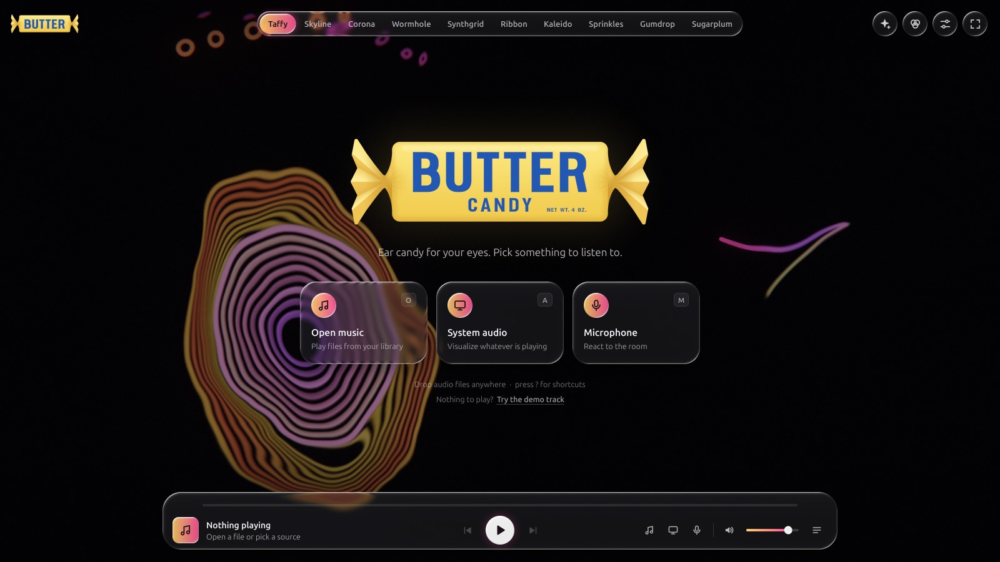
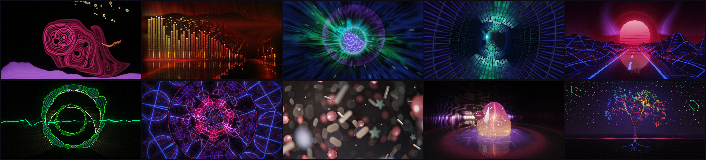
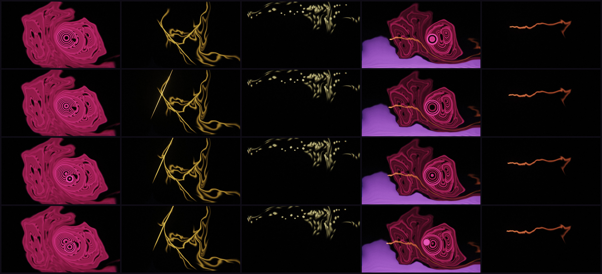
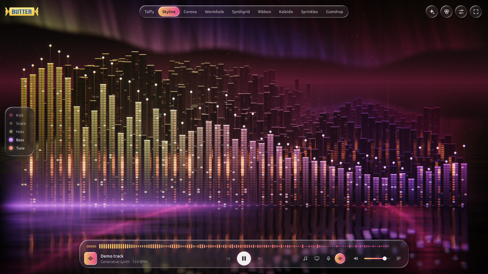
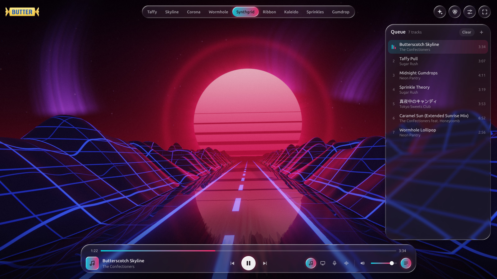

# buttercandy

Ear candy for your eyes: a music visualizer in the spirit of the old Windows
Media Player visualizations, rebuilt on a modern GPU pipeline.



It visualizes **whatever your computer is playing**, **your own music files**,
or a **microphone**, through thirteen shader presets in two genres and sixteen
colour palettes,
with a custom GPU-drawn interface that gets out of the way while the music
plays.



## Features

- **Three audio sources**
  - *System audio*: loopback capture of the default output, so Spotify, a
    browser tab or a game all just work.
  - *Built-in player*: MP3, FLAC, WAV, Ogg Vorbis, AAC/M4A, ALAC, AIFF and
    more, with a queue, seeking, tags and cover art. Drop files or folders on
    the window.
  - *Microphone / line-in*.
  - Plus a built-in generative **demo track**, so there is something to watch
    with zero setup.
- **Thirteen presets** that show what the music is doing, not just how loud
  it is, in two genres: the ten *Classics* and the *Fractals*. Presets
  cross-dissolve, and can auto-cycle on the beat within their genre.
  - *Taffy*: ink marbling. The kick drops ink that shoves the rest into
    rings, the snare drags a stylus through it, the bass is a tide.
  - *Skyline*: the spectrum as a city on water. The kick rings the water,
    the snare streaks the sky, the tune lights the windows.
  - *Corona*: a star. The kick is its shock wave, the snare a jet, the tune
    its prominences.
  - *Wormhole*: a winding tunnel tiled with the spectrogram. The kick
    squeezes it, the snare splits a seam, the tune flowers at the far end.
  - *Synthgrid*: a neon highway through mountains made of the spectrogram.
    The sun is the kick; when the kick drops out, it goes into eclipse.
  - *Ribbon*: an oscilloscope. Every drum hit freezes the trace, which
    peels off as a ribbon in that drum's colour.
  - *Kaleido*: a tunnel of kaleidoscopes, steered by the harmony.
  - *Sprinkles*: candy under a macro lens: balls for the kick, stars for
    the snare, sugar for the hats, rods for the tune.
  - *Gumdrop*: a sugared jelly on a mirror. The kick squashes it, the snare
    sweeps a sheet of light across it, the bass pools under it.
  - *Sugarplum*: a tree that forks once for every octave, so low notes are
    the trunk and high notes the twigs. The kick climbs it, the snare cracks
    a bough, the bass line lights the roots, and the tune ripens the fruit
    and draws a constellation in the sky for each note it sounds.
- **The Fractals** fall inward for ever, and put the voices at the scales
  they live at: the kick on the biggest things in the picture, the hats on
  the finest, the tune on a band of scales that slides with its pitch.
  - *Jawbreaker*: a real dive into the Mandelbrot set, a hundred thousand
    million times deep at a stretch, drawn as a sweet cut open: layer inside
    layer round the set, in carved relief. Each fall ends at a miniature
    copy of the whole set, and the next one begins from it, never the same
    way twice. The snare cracks the layers along the set's own rays.
  - *Gumball*: glass sweets packed for ever (an Apollonian gasket), every
    one big enough to see into holding the whole packing again. The bass
    fills the big ones like syrup; on the snare they clack, with a spark
    wherever two touch.
  - *Gingerbread*: a flight down a hall with no end, its pillars and vaults
    made of chains of pearls. The kick is a wave of light from its far end,
    the tune a line of light round every pillar, the snare light in the
    seams between the pearls.
- **Sixteen palettes** that recolour every preset *and* the interface, from
  candy pastels to a thermal camera. Each one also assigns the five voices
  their colours.
- **HDR pipeline**: presets render to 16-bit float with feedback buffers,
  followed by multi-scale bloom, chromatic aberration, vignette, ACES
  tonemapping and film grain.
- **It hears five voices, and shows you which is which.** The analyser tells
  the kick, the snare (or clap), the hi-hats, the bass line and the tune
  apart by their sound, not just their pitch: a snare's sizzle is not a hat,
  the click of a kick is not a snare, a plucked note is not a drum. Every
  preset then answers each voice in the same three ways at once: its own
  colour from the palette, its own kind of motion (a kick is a slow heavy
  push, a snare a crack, hats a sparkle, bass a swell, the tune a glide) and
  its own place in the picture. Learn it in one preset and it holds in all
  of them. A key (`K`) shows what is being heard.
- **Audio analysis** underneath: log-frequency spectrum with automatic gain,
  peak hold, band energies and a scrolling spectrogram; spectral-flux onsets
  classified by the shape of the new sound; spectral centroid; chroma
  (energy per pitch class) and the harmony's place on the circle of fifths.
- **Custom interface**: every panel, icon and glyph is drawn by one shader:
  liquid glass that refracts the visuals behind it, with lit, bevelled edges;
  vector icons; system fonts with full Unicode fallback. It fades out when
  you stop moving the mouse.
- **A logo drawn in code**: a wrapped sweet in the shape of a stick of butter,
  lettering included, rasterised from signed distances at whatever size it is
  needed (`src/ui/logo.rs`).
- **Headless rendering**: render any preset to a PNG with no window or audio
  device (handy for wallpapers, and how the visuals are tested).



*One column per voice, each playing alone: kick, snare, hats, bass line, tune.*





## Installing

Each [release](https://github.com/ptweezy/buttercandy/releases) carries a
ready-made build, with a `SHA256SUMS` file to check it against:

| System | Download | Then |
| --- | --- | --- |
| Windows, x64 or ARM64 | `buttercandy-windows-amd64.zip` or `-arm64.zip` | Unzip anywhere and run `buttercandy.exe`. |
| macOS 14.2 or newer, Apple silicon or Intel | `buttercandy-macos-universal.dmg` | Open it and drag buttercandy to Applications. |
| Linux, x64 or ARM64 | `buttercandy-linux-amd64.tar.gz` or `-arm64.tar.gz` | Unpack, then run `./buttercandy --install-desktop` once (see below). Needs a Vulkan driver and glibc 2.39 or newer. |

A release's notes say whether its Windows and macOS builds are code-signed,
and how to open them when they are not.

## Building

You need a recent stable [Rust toolchain](https://rustup.rs) (edition 2024).

```bash
cargo run --release
```

Platform notes:

| Platform | Extra requirements |
| --- | --- |
| Windows | None. |
| macOS | None. System-audio capture needs macOS 14.6 or newer. |
| Linux | ALSA headers to build: `sudo apt install libasound2-dev` (Debian/Ubuntu) or `sudo dnf install alsa-lib-devel` (Fedora). A Vulkan driver to run. Under X11 (rather than Wayland) also `libxkbcommon-x11-0`. |

On Linux, run it once with `--install-desktop` to add buttercandy to the
applications menu with its icon:

```bash
cargo run --release -- --install-desktop
```

A Linux desktop takes a window's icon from its launcher entry, not from the
window, so without this the dock shows a generic icon. It writes only to your
own `~/.local/share`; `--uninstall-desktop` removes it.

> **Tested on Windows 11 and Ubuntu 26.04** (NVIDIA, Vulkan; on Ubuntu under
> Wayland). Not yet run: macOS, Linux under X11, and the OpenGL fallback in a
> window (`WGPU_BACKEND=gl` renders headlessly, but on NVIDIA under Wayland
> wgpu finds no OpenGL configuration it can present with). On Wayland there
> is no drag-and-drop and no window icon. The
> [CI workflow](.github/workflows/release.yml) builds and tests all three
> systems on every push, on x64 and ARM64.

## Using it

buttercandy starts out listening to whatever your computer is playing: put
some music on and it moves. Pick another source from the dock, or:

| Key | Action |
| --- | --- |
| `Space` | Play / pause (stop listening, for live sources) |
| `←` `→` | Previous / next preset of the genre |
| `1` – `9`, `0` | Jump to a preset of the genre |
| `G` | Next genre of presets |
| `[` `]` | Previous / next palette |
| `-` `=` | React less / more to the music |
| `K` | Show the key: which voice is which colour, and what is playing |
| `C` | Auto-cycle presets |
| `↑` `↓` | Volume |
| `N` `B` | Next / previous track |
| `O` | Open music files |
| `A` | Capture system audio |
| `M` | Microphone |
| `D` | Demo track |
| `Q` | Show the queue |
| `F` / `F11` | Fullscreen |
| `H` | Hide / show the controls |
| `S` | Save a screenshot (to `Pictures/buttercandy`) |
| `?` | Shortcut reference |
| `Esc` | Close a panel / leave fullscreen |

Settings (preset, palette, volume, sensitivity, reactivity, glow, auto-cycle,
graphics quality, target frame rate) are saved to the platform config
directory, e.g. `%APPDATA%\buttercandy\settings.json`.

*Sensitivity* is gain: how loud the music has to be to fill the picture.
*Reactivity* is temperament: how hard the picture moves when something
happens. At 100% every kick, clap and hi-hat lands with full force; at the
default 50% they still show, as swells rather than jolts; at 0% the presets
drift and breathe.

*Graphics quality* is the resolution the visuals are drawn at, from a quarter
of the window's up to all of it: lower is softer and lighter on the GPU.
*Target frame rate* holds the picture to a number of frames a second, to
spare the GPU or the battery. At the top of its slider there is no target and
the display sets the pace. A target just under the display's own rate cannot
be held steadily, so the targets stop at about 85% of it. The mouse wheel
moves either slider one step at a time.

### System audio on each platform

- **Windows**: WASAPI loopback of the default output device.
- **macOS 14.6+**: CoreAudio process taps (the system will ask for permission).
- **Linux**: the monitor source of the default output, found through the
  sound server (PulseAudio, or PipeWire's PulseAudio service). Without one,
  buttercandy opens the default input instead; point that at your output's
  monitor source, e.g. in `pavucontrol` under *Recording*.

### Command line

```text
buttercandy [options] [files or folders...]

  --preset <id>        start on a preset
  --palette <id>       start with a palette
  --demo | --mic | --idle
                       start with the demo track, the microphone or nothing,
                       instead of system audio
  --volume <0..1>      playback volume
  --target-fps <n>     hold the picture to n frames a second
  --fullscreen         start fullscreen
```

Headless rendering, with the demo track as the audio source:

```bash
cargo run --release -- --shot wallpaper.png --preset synthgrid --palette synthwave --size 3840x2160
```

`--ui <state>` also draws the interface (`hero`, `demo`, `player`, `queue`,
`palette`, `settings`, `help`, `drop`), `--skip` and `--seconds` choose the
moment, and `--silent` renders the idle animation. `--sheet 3x2 --every 0.8`
saves a contact sheet of successive frames, `--sheet palettes` the same
moment in every palette and `--sheet presets` in every preset of the chosen
preset's genre; a name ending
in `.jpg` saves a JPEG. `--logo-sheet logo.png` saves the logo at every size
it is used, and `--icon icon.png --size 512x512` the app icon alone.
`buttercandy --help` lists everything.

## How it works

```text
            ┌────────────┐   ┌─────────┐
 files ───> │  decoder   │──>│  ring   │──┐
            │  thread    │   └─────────┘  │   ┌──────────────┐
            └────────────┘                ├──>│ output       │──> speakers
 demo synth ──────────────────────────────┘   │ callback     │
                                              └──────┬───────┘
 system audio / mic ──> capture callback ────────────┤
                                                     v
                                               ┌──────────┐
                                               │   tap    │  newest N samples
                                               └────┬─────┘
                                                    v
 FFT -> spectrum, peaks, bands, onsets, chroma, spectrogram    (once per frame)
                                                    v
   preset (HDR, feedback) -> bloom -> composite -> blurred backdrop
                                                    v
                                     blit + interface -> screen
```

| Path | What lives there |
| --- | --- |
| `src/audio/` | The engine (`mod.rs`), decoder thread and seeking (`player.rs`), polyphase resampler, FFT, analysis, demo synth and the lock-free buffers. |
| `src/gfx/` | wgpu setup, the visualizer pipeline (`renderer.rs`), the preset table, preset drivers and all WGSL (`shaders/`). |
| `src/ui/` | The UI toolkit (`mod.rs`), text shaping and glyph atlas, icon and logo rasterizers, its renderer, and the interface itself (`view.rs`). |
| `src/stage.rs` | Analysis + visualizer + interface, shared by the app and headless mode. |
| `src/app.rs` | Window, input, playlist and actions. |
| `src/shot.rs` | Headless rendering. |

The audio callbacks never lock, block or allocate: samples cross threads
through atomics-backed ring buffers (`src/audio/ring.rs`).

### Writing a preset

A preset is one WGSL file defining

```wgsl
fn scene(uv: vec2f) -> vec3f   // linear HDR colour; values above 1 bloom
```

`src/gfx/shaders/preset_header.wgsl` documents what it can use, and the
contract every preset follows: **the five voices**. Each voice has a colour
(`voiceCol(KICK)`), a motion (`kickEnv(k)`, `snareEnv(k)`, `hatEnv(k)`,
`noteEnv(k)`, `uBassLine`, `uPitch`) and a place, and whatever a voice sets
off is drawn in its colour, with its motion, in its place. `pal(t)` is for
the scenery. Also there:

- the sound as pictures: `spec(x)`, `wave(x)`, `peak(x)`, the spectrogram via
  `histRow(x, row)`, and `chroma(i)` for the twelve pitch classes;
- per hit of each drum voice: a count to seed randomness, the ages of the
  last four hits (so a ripple knows how far it has travelled, and the one
  before it fades out rather than vanishing) and how hard each was;
- slow, structural signals for the scenery: `uEnergy` (breakdown or full),
  `uCentroid` (brightness), `uHarmony` (where the chord sits);
- `prev(uv)`, the previous frame, for feedback;
- `uReact`, the user's reactivity setting, which the voice envelopes already
  follow and which a preset applies to anything else that moves.

To work on one without rebuilding, render it straight from the file:

```bash
cargo run --release -- --shot out.png --preset-file my.wgsl --sheet 3x2 --every 0.8 --size 640x360
```

A compile error is reported with the file's own line numbers, and every run
prints the GPU time per frame. `--motion` also measures how much the picture
changes from frame to frame, which is how "too jumpy" gets a number.
`--sheet voices` plays each voice of the demo track alone, one column each,
which is the test of the contract: a stranger should be able to label the
columns. To ship it, add the file to
`src/gfx/shaders/presets/` and one line to `PRESETS` in `src/gfx/presets.rs`,
which also says which genre it belongs to.

A fractal goes in the Fractals genre, whose presets also get
`src/gfx/shaders/fractal.wgsl` (to render one from a file, name any fractal
with `--preset` so that the file gets it too): the genre's rules (depth is pitch; a hit
lights the shape and never bends it; everything falls inward) and the helpers
that place the voices the same way in all of them.

A shader has 32-bit floats and no memory. A preset that needs more can have a
*driver* (`src/gfx/driver.rs`): a piece of Rust that runs once a frame and
hands the shader forty numbers and a table. Jawbreaker's
(`src/gfx/jawbreaker.rs`) finds the miniature copies of the set to fall to
and works their orbits out in 64 bits.

A preset can also keep hidden state (`stateful` in the preset table). Instead
of `scene` it defines `state`, four numbers a pixel that are kept from frame
to frame and never shown, and `show`, which makes the picture from them in a
second pass. Jawbreaker keeps where each pixel lies in the set, which is slow
to work out and does not depend on the music, and paints the voices over it
afresh every frame.

## Tests

```bash
cargo test
```

covers the DSP (FFT, resampler, onsets, chroma, the synth), the player thread
end to end (load, sample-accurate seek, end of stream), file-name parsing, the
icon rasterizer, Jawbreaker's dive (its 32-bit loop against plain 64-bit
iteration), and validates every shader with naga, all without a GPU or an
audio device.

## Releases

One workflow, [release.yml](.github/workflows/release.yml), does both jobs.
Every push and pull request is formatted, linted, tested and built into the
same downloads a release ships. A release is that run plus a tag and a GitHub
Release, and happens only when:

- a commit pushed to `main` has a subject starting with `[release]`,
  `[release:patch]`, `[release:minor]` or `[release:major]`, or
- the workflow is run by hand, with a bump level or an exact version.

The version is counted from the latest tag (tags are bare `X.Y.Z`) and stamped
into the build, so `buttercandy --version` on a release reports its tag; the
version in `Cargo.toml` is only what a local build reports. A `## X.Y.Z`
section in a `HISTORY.md`, if there is one, leads the release notes. Signing
is optional: the header of the workflow lists the secrets that turn it on.

## Not yet

- Media keys and OS "now playing" integration.
- Gapless playback, shuffle and repeat modes (the queue currently loops).
- Opus decoding (not supported by the decoder library in use).
- Picking a specific audio device; the system defaults are used.
- Loading user presets from disk at runtime.

## Contributing

Contributions are welcome. buttercandy has a single owner, so anything
contributed is assigned to Parker Loflin; [CONTRIBUTING.md](CONTRIBUTING.md)
has the terms and how to send a change.

## Licence

Copyright (C) 2026 Parker Loflin.

buttercandy is free software: you can redistribute it and modify it under the
terms of the GNU Affero General Public License, version 3, as published by
the Free Software Foundation. It is distributed in the hope that it will be
useful, but WITHOUT ANY WARRANTY; without even the implied warranty of
MERCHANTABILITY or FITNESS FOR A PARTICULAR PURPOSE. See [LICENSE](LICENSE)
for the full text.

In short: you may use, study, share and change it, but anything you
distribute that is built from it, or offer to others over a network, has to
be released under the same licence with its source. To use it on other terms,
ask the owner.

[THIRD-PARTY.md](THIRD-PARTY.md) credits the few pieces adapted from other
people's work.
